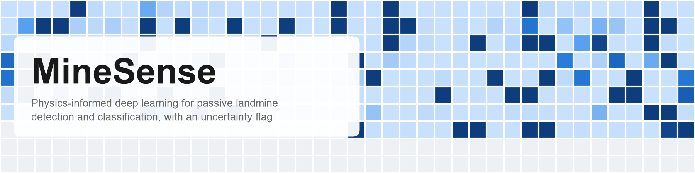
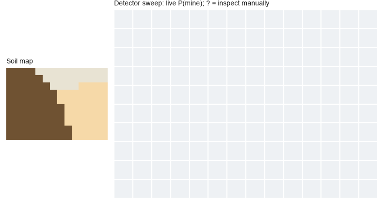
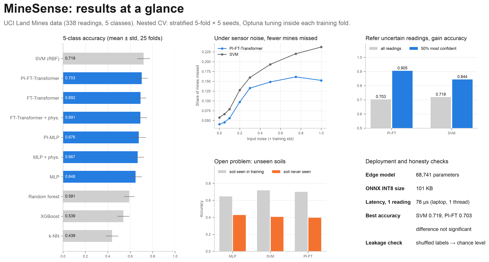
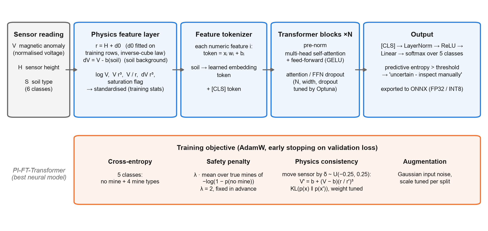

<!-- Generated by `python -m minesense.numbers` from docs/README.template.md; edit the template. -->
<p align="center"></p>

# MineSense

**Physics-informed deep learning for passive landmine detection and classification, with an "uncertain - inspect manually" flag.**

**Live demo:** _coming soon_ <!-- LIVE_DEMO_URL: replace with the Streamlit Community Cloud link -->

MineSense classifies a magnetic-anomaly reading from a passive (fluxgate) detector into *no mine* or one of four mine types, using the reading's voltage **V**, the sensor height **H** and the soil type **S**. It is a deep learning course project on the UCI *Land Mines* dataset (338 readings). The repository holds the full pipeline: nested cross-validation, a physics-informed FT-Transformer, uncertainty and calibration analysis, an ablation study, an ONNX edge model and a Streamlit app with a minefield simulation.

<p align="center"><br>
<em>Minefield simulation: the detector sweeps a field with mixed soils and hidden mines; the map shows the model's live mine probability, <b>?</b> marks readings flagged for manual inspection, and circles reveal the true mines at the end. Readings are synthetic (generated from the inverse-cube law fitted to the data; here at height level 5 of 11 with twice the fitted sensor noise), so this is a demonstration, not an accuracy test.</em></p>

## Results at a glance

<p align="center"></p>

All numbers come from **nested cross-validation**: stratified 5-fold CV repeated over 5 seeds (25 test folds of 67-68 readings), with Optuna tuning inside every training fold, so no test fold ever influenced a model or a hyperparameter.

| Model | Accuracy | Macro F1 | Detection (mine vs none) | Mines missed | False alarms |
|---|---|---|---|---|---|
| SVM (RBF) *(baseline)* | 0.719 ± 0.057 | 0.706 | 93.1% | 5.8% | 11.3% |
| **PI-FT-Transformer** | 0.703 ± 0.052 | 0.693 | 92.4% | 4.0% | 20.9% |
| FT-Transformer | 0.692 ± 0.049 | 0.682 | 92.8% | 4.2% | 18.6% |
| FT-Transformer + phys. features | 0.691 ± 0.059 | 0.685 | 92.0% | 3.6% | 24.5% |
| PI-MLP | 0.676 ± 0.062 | 0.669 | 91.8% | 3.3% | 26.5% |
| MLP + phys. features | 0.667 ± 0.056 | 0.661 | 91.5% | 3.6% | 27.1% |
| MLP | 0.648 ± 0.055 | 0.643 | 91.4% | 2.1% | 33.0% |
| Random forest *(baseline)* | 0.591 ± 0.048 | 0.576 | 90.6% | 7.3% | 17.5% |
| XGBoost *(baseline)* | 0.539 ± 0.054 | 0.523 | 88.6% | 8.5% | 22.4% |
| k-NN *(baseline)* | 0.439 ± 0.055 | 0.421 | 78.8% | 15.7% | 41.7% |

What the experiments show:

- **The SVM baseline is the most accurate single model.** The SVM reaches 0.719 and our best neural model, the physics-informed FT-Transformer (PI-FT), reaches 0.703. The 1.6-point gap is not significant (corrected repeated-CV *t*-test, *p* = 0.66). PI-FT is significantly better than random forest, XGBoost and k-NN.
- **The neural model is the better choice when uncertain readings can go to a human.** If only the 50% most confident readings are decided automatically, PI-FT is correct on 90.5% of them and the SVM on 84.4%: 19 wins and 3 losses over the 25 folds (Wilcoxon *p* < 0.001; the conservative corrected test gives *p* = 0.076).
- **The neural model misses fewer mines under sensor noise.** With Gaussian noise of 0.5× each input's spread, PI-FT misses 14.8% of mines and the SVM 19.3% (fewer misses in 24 of 25 folds, corrected *p* = 0.0031).
- **The uncertainty flag works.** The deployed flag sends 19.5% of readings to manual inspection. Accuracy is 77.2% on the rest and 41.6% on the flagged ones, and only 3.1% of mines are missed without a flag.
- **Physics helps a little, not significantly.** Physics features plus the physics-consistency loss add 2.8 points to the MLP and 1.1 to the FT-Transformer (*p* = 0.36 and *p* = 0.66). The fitted height offset (d0 ≈ 1.73 in normalised height units) exceeds the whole height range, so over 0-20 cm the 1/r³ law is nearly linear and adds little information.
- **New soils remain an open problem.** On a soil type never seen in training, every model falls to 34.8-42.8% accuracy (leave-one-soil-out).
- **No leakage was found.** With shuffled training labels, the tested models score 19.4-22.3%, which is chance level for 5 classes.

## How it works

<p align="center"></p>

- **Models:**
  - an MLP (soil embedding, batch norm, dropout, weight decay, early stopping);
  - an FT-Transformer (Gorishniy et al., NeurIPS 2021);
  - physics-informed versions of both;
  - baselines: k-NN, SVM, random forest, XGBoost.
- **Physics:**
  - The magnetic anomaly of a buried object decays roughly as 1/r³.
  - Features: log V, V·r³, V/r, the soil-background-corrected anomaly dV·r³ and a saturation flag, where r = H + d0 and d0 is fitted on training rows only.
  - Physics-consistency loss: the model must predict the same class for a reading moved to another height with the inverse-cube law.
- **Safety:**
  - A cost-sensitive term, λ·(−log(1 − p(no mine))) on true mines, penalises calling a mine empty ground.
  - λ = 2 was fixed before any experiment; a sweep shows the full trade-off between missed mines and false alarms.
- **Evaluation:**
  - accuracy, macro F1, per-class precision and recall, confusion matrices, loss curves;
  - Wilcoxon, McNemar and corrected repeated-CV *t*-tests with Holm correction;
  - MC dropout, reliability diagrams, ECE and temperature scaling;
  - robustness to test-time noise, a full ablation study, SHAP explanations, leave-one-soil-out transfer.

## Edge deployment

The deployed model is PI-FT trained with the same tuning procedure on all readings, exported to ONNX and quantised to INT8.

| Format | Size | Latency, one reading | Throughput, batch of 4096 |
|---|---|---|---|
| PyTorch (eager) | 279 KB | 132 µs | 70,208 readings/s |
| ONNX Runtime FP32 | 283 KB | 78 µs | 68,113 readings/s |
| ONNX Runtime INT8 | 101 KB | 76 µs | 63,214 readings/s |

The model has 68,741 parameters. Timings are from one CPU thread of the development laptop (Apple M5), not from an embedded board; expect a handheld or drone processor to be slower.

The INT8 model agrees with the FP32 model on 99.85% of 20,000 random in-range readings and on the uncertainty flag for 99.76%.

The flag uses one deterministic pass: its predictive entropy ranked readings as well as 50-pass MC dropout in cross-validation, so the device needs no repeated passes.

## Comparison with the original study

Yilmaz et al. (IEEE Access, 2018) report 85.8% classification and 98.2% detection accuracy for a meta-heuristic k-NN. Their numbers come from **one random split with 113 test readings**, and the feature weights were optimised with a fitness function computed on "test observations". Our protocol is stricter and reports the spread:
- PI-FT's 5-class accuracy is 70.3% on average.
- On single test folds it ranges from 58.8% to 83.8%, which shows how much one small split can move the reported number.
- Its detection accuracy (mine vs. no mine) is 92.4%.

## Run it yourself

```bash
python3.12 -m venv .venv && source .venv/bin/activate
pip install -r requirements.txt && pip install -e .     # macOS: brew install libomp (XGBoost)

python -m minesense.download --with-uci   # dataset from Kaggle (+ UCI copy for the audit)
python -m minesense.audit                 # duplicates, missing values, leakage checks
python -m minesense.eda                   # exploratory figures
python -m minesense.cv                    # nested CV, all 10 models (about 1 h on 10 cores)
python -m minesense.loso                  # leave-one-soil-out
python -m minesense.summary               # Stage 2 tables and figures
python -m minesense.evaluate              # metrics, significance tests, benchmark
python -m minesense.reliability           # MC dropout, calibration, selective prediction
python -m minesense.robustness            # test-time noise
python -m minesense.ablation              # ablation study (about 6 min)
python -m minesense.explain               # SHAP
python -m minesense.final                 # deployed model
python -m minesense.export                # ONNX + INT8, timing, app assets
python -m minesense.docs_figures          # architecture, banner, summary slide, demo GIF
python -m minesense.numbers               # report tables/macros and this README
python -m minesense.check_docs            # verify every number in README/report against results/
pytest                                    # unit tests, including app smoke tests
(cd report && tectonic main.tex)          # build the IEEE report PDF (any LaTeX engine works)

streamlit run app/streamlit_app.py        # the demo app (needs only app/requirements.txt)
```

Seeds are fixed throughout. Training runs on the CPU: for these small models it is faster than Apple's MPS GPU backend (FT-Transformer: 1.06 s vs 2.55 s per 100 epochs).

## Repository layout

```
src/minesense/   pipeline: data, models, training, CV, evaluation, export
app/             Streamlit app (ONNX Runtime only) and the minefield engine
results/         tables/ and figures/ produced by the scripts (models and logs are not committed)
report/          IEEE-format report (LaTeX)
docs/            banner, demo GIF, README template
tests/           unit tests
data/            downloaded data (not committed; see data/README.md)
```

## Data and citation

Dataset: C. Yilmaz, H. T. Kahraman and S. Söyler, *Land Mines*, UCI Machine Learning Repository, doi:[10.24432/C54C8Z](https://doi.org/10.24432/C54C8Z), CC BY 4.0. Original study: C. Yilmaz, H. T. Kahraman and S. Söyler, "Passive Mine Detection and Classification Method Based on Hybrid Model," *IEEE Access*, vol. 6, pp. 47870-47888, 2018, doi:[10.1109/ACCESS.2018.2866538](https://doi.org/10.1109/ACCESS.2018.2866538).

## Licence

The code is released under the [MIT licence](LICENSE). The dataset is not part of this repository and keeps its own licence (see above).

## Authors

_To be added._
